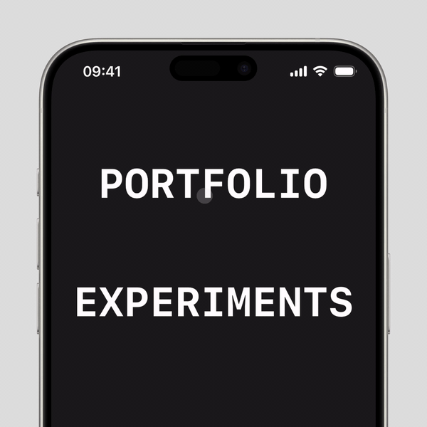

# Elastic Text

Text that bends like a rubber string when you drag it, then springs back. Built entirely in pure SwiftUI, in a single file.



## Example

```swift
ElasticText(text: "PORTFOLIO")
ElasticText(text: "HELLO", fontSize: 32, spacing: 20, maxBend: 40)
```

## Credits

Inspired by the [CSS-only elastic hover effect](https://x.com/ChallengesCss/status/2018627183292633517) by Temani Afif.
